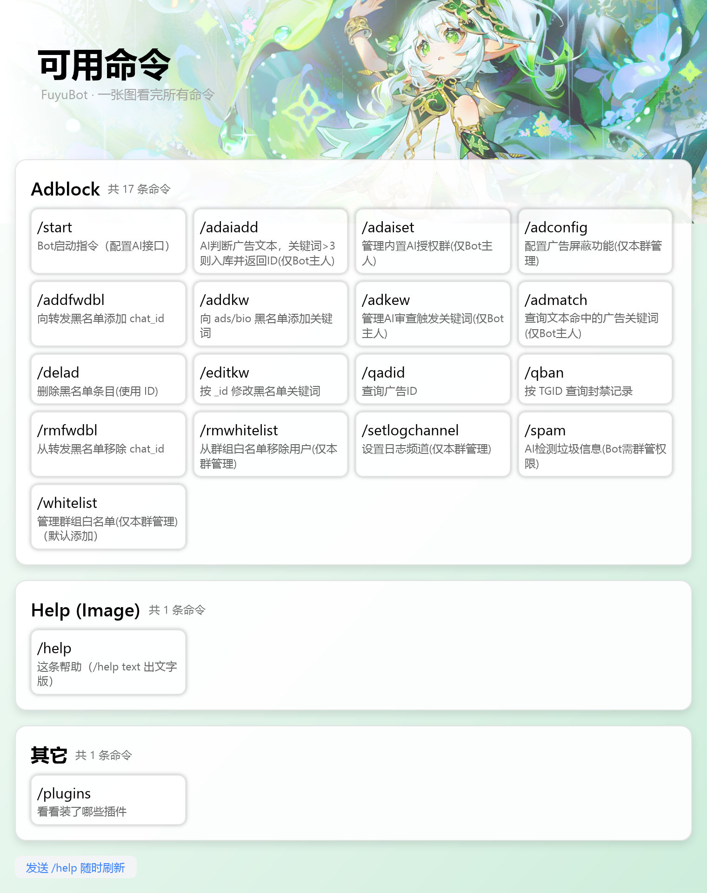

# fuyubot-plugin-help

FuyuBot 的 **`/help` 图片版**：把命令表渲染成一张图片发回聊天，替代框架内置的
`/help` 文本回复。

它不是「另一个 help」：**插件 id 与内置 help 相同（`fuyubot.help`）**。从
FuyuBot 0.1.5 起命令表归宿主（`fuyubot.host.commands`）：`/start`、`/plugins`、
adblock 等插件各自登记，本插件只读 `list` 并按命令的能力过滤、渲染。

[](https://github.com/deepseek-ai/deepseek-harness)



## 它做什么

- 订阅 `/help`（含 `/help@本Bot`），问宿主要当前命令表（`fuyubot.host.commands` 的 `list`），交给
  [`fuyubot.html2img`](../fuyubot-plugin-html2img/) 渲染成 JPEG / PNG，再按
  `reply_to_message_id` 发回原消息。
- `/help t` / `/help text` 回**文字版**：同一份分组数据，不渲染、不吃 CPU，图片太大或
  不方便看图时用；其它参数（含裸 `/help`）照旧出图。
- **回复形态交给宿主**：出图后走宿主的命令回复服务（`fuyubot.host.command`）——
  普通的发新消息 + 回原命令；user 账户自己敲的 `/help` 由宿主编辑原消息；
  群里的 ephemeral 命令发只对执行者可见的临时消息。插件不自己判断账号类型。
- **命令按插件分组**：一个登记命令的插件一张卡片，组标题优先用宿主报告的展示名
  （`广告拦截（adblock）`），没有归属的收在最后的「其它」里。归属由宿主判定
  （ABI v6 的调用者栈）——登记方在自己的线程上调进来也认得，插件自报的名字不算数。
- 图片生成 / 发送失败时，按配置补发一条**纯文本命令表**（`fallback_text = true`），
  保证 `/help` 不会什么都不回。
- **按宿主命令表的权限过滤**：`hidden` 不进列表；`role`（user / chat_admin / admin /
  owner）和 `scopes`（private / group / channel）按当前用户与会话裁剪。图片版、
  文字版、统计数字吃同一份过滤结果。
- 不再维护静态兜底：`start` / `help` / `plugins` 都由各自插件登记，没登记就不显示。

## 硬依赖：`fuyubot.html2img`

`Plugin::inject()` 声明了 `fuyubot.html2img`（由
[`fuyubot-plugin-html2img`](../fuyubot-plugin-html2img/) 提供的进程级共享服务）：

- 没装 / 没启用 html2img 时，本插件**停在 Pending**，不会静默退化成文字版；
- html2img 默认输出 JPEG，本插件默认也是 `jpg`（可配 `png`）；
- 交给出图服务的是 `{"html": 模板, "vue": true, "data": {...}}`，模板在
  [`assets/help.html`](assets/help.html)，编译期打进动态库。

## 安装（重要：与内置 help 同 id）

两者 id 相同，**不能同时加载**。装本插件前先移走或禁用内置的平铺 DLL
（禁用就是改名：`fuyubot_plugin_help.dll` → `fuyubot_plugin_help.dll.disable`）：

```text
plugins/
├── fuyubot_plugin_help.dll.disable  ← 内置 help：移走 / 改名 / 用面板禁用
├── fuyubot.help/                    ← 本插件（目录包）
│   ├── plugin.json
│   └── bin/fuyubot_plugin_help.dll
└── fuyubot.html2img/                ← 硬依赖
    ├── plugin.json
    └── bin/fuyubot_plugin_html2img.dll
```

如果内置 DLL 还在，宿主会看到两个同名插件（`fuyubot.help`），加载会因重复
id 失败（或者其中一份被跳过）——这不是本插件的 bug，是「替代」本身的约束。

> ⚠️ **别只删内置 DLL**：`fuyubot run` / `init` 会重新把内置插件装回来。
> 用面板禁用，或把文件改名成 `fuyubot_plugin_help.dll.disable`（加载器只认
> 后缀正好是 `.dll` 的文件，`install_builtins` 也把 `.disable` 当作「已存在」）。

想装回内置 help，反向操作即可：删掉 `plugins/fuyubot.help/`，把内置 DLL 改回
`fuyubot_plugin_help.dll`（或面板里重新启用）。

## 配置

配置段 `[plugin.fuyubot.help]`，全部可省略：

```toml
[plugin.fuyubot.help]
title = "可用命令"
description = "FuyuBot · 一张图看完所有命令"
tips = "发送 /help 随时刷新"
table_desc = "共 {count} 条命令"
image = "https://files.catbox.moe/py80s6.jpg"
width = 760
height = 600
scale = 2.0
format = "jpg"                # jpg / png
max_commands = 120
send_timeout_ms = 30000
fallback_text = true
```

| 键 | 默认 | 说明 |
| --- | --- | --- |
| `title` | `可用命令` | 图片大标题 |
| `description` | `FuyuBot · 一张图看完所有命令` | 副标题 |
| `tips` | `发送 /help 随时刷新` | 左下角小提示 |
| `table_desc` | `共 {count} 条命令` | **每组**（一个插件一张卡）的说明，支持 `{count}`（本组条数）/ `{plugins}`（来源插件数）/ `{version}` |
| `image` | catbox 头图 | 头图 URL；支持 `http(s)` / `data:`，**置空则不画头图** |
| `width` | `760` | 渲染宽度（CSS px），夹到 320–1920 |
| `height` | `600` | 高度下限（`auto_height` 会按内容撑开） |
| `scale` | `2.0` | 输出倍率，夹到 1.0–3.0 |
| `format` | `jpg` | 输出格式 |
| `max_commands` | `120` | 单图最多画多少条，超出截断并提示 |
| `send_timeout_ms` | `30000` | 等 TDLib 发送结果的预算 |
| `fallback_text` | `true` | 出图 / 发送失败时补发文字版 |

### 权限与可见性

「谁能在哪看见哪条命令」不再由 help 自己的白 / 黑名单决定，而是**由命令表里的
`role` / `scopes` / `hidden` 决定**——登记命令的插件写什么，`/help` 就按什么过滤：

| 字段 | 默认 | `/help` 行为 |
| --- | --- | --- |
| `hidden` | `false` | `true` 时不进列表 |
| `role` | `user` | `user` / `chat_admin`（本群管理）/ `admin` / `owner` 逐级过滤 |
| `scopes` | `private + group` | 只显示与当前会话类型（私聊 / 群 / 频道）匹配的命令 |

过滤在 `/help` 的工作线程里做：全局角色问宿主 `role` 方法（纯内存），会话类型与
群管理权先读宿主对象缓存（`fuyubot.host.cache`，`chat_member` 30 秒 TTL），
未命中再问一次 TDLib。因此群管理员能看到 `chat_admin` 命令，普通群员看不到。

> `image` 走 html2img 的远程资源能力（仅公网 `http(s)` 与 `data:`；不要填
> `file://` 或局域网地址）。头图拉取失败不会让整张图失败，只是没有头图。
> 完全不想联网就写 `image = ""`。`data:` 会算进 html2img 的 `max_html_bytes`
> （默认 128 KiB），大图请用 URL，别塞 base64。

## 和其它插件的关系

- **命令表由宿主提供**：其它插件在 `start()` 里
  `call_service("fuyubot.host.commands", "register", ...)`，登记时带上
  `role` / `scopes` / `hidden`；旧的 `fuyubot.help.commands` 是宿主的兼容别名，
  新代码不要再用，也不需要 `soft_inject` 等 help。
- **本插件硬依赖** `fuyubot.html2img`：图片渲染服务。
- 命令表在宿主里，所以 help 没装、被禁用或卸载都不影响其它插件登记命令。

## 开发

```bash
# 只测本插件（不编译 hyper-render）
cargo test -p fuyubot-plugin-help

# 打 bundle（与其它插件同一套脚本）
python scripts/package.py --plugin fuyubot-plugin-help \
    --platform windows-x86_64 --version 0.1.3
```

模板在 [`assets/help.html`](assets/help.html)：布局参照 `help.vue`（Tailwind 版），
这里改写成手写 CSS——`hyper-render` 不跑 JS、也没有 Tailwind 运行时，所以只保留
模板用到的那组布局 / 颜色规则，并把 `body` 内边距压成 0，让渐变背景铺满整张图。
改模板后跑一遍 `cargo test -p fuyubot-plugin-help`，单测会用 `vue-template-html`
把同一份模板编译并渲染，确认 `{{ }}` / `v-for` / 空列表都能正常出 HTML。

## 许可

MIT OR Apache-2.0。
