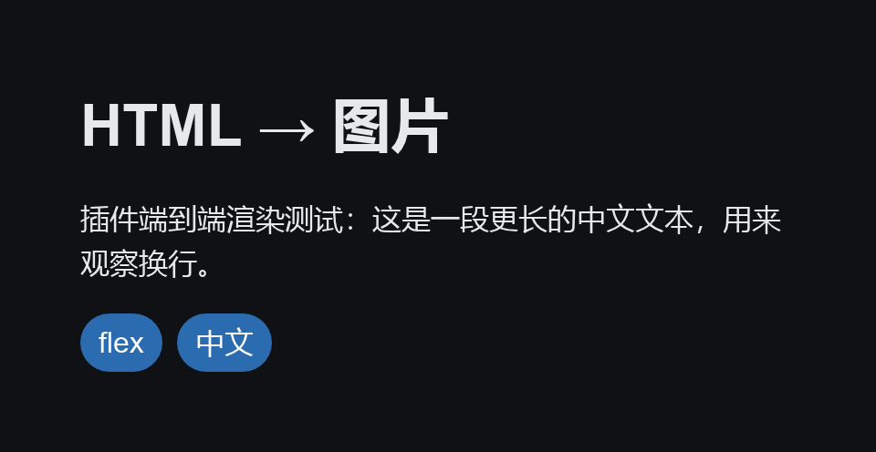

# fuyubot-plugin-html2img

FuyuBot 的 HTML / Vue 转图片服务。插件启动后注册进程级服务 `fuyubot.html2img`，别的插件调用 `render` 方法，就能把 HTML、CSS 或 Vue 模板渲染成 PNG / JPEG，拿到本机文件路径。默认输出 JPEG。

渲染器是 [hyper-render](https://github.com/thomasmost/hyper-render) 的本地 fork，纯 Rust，不需要 Chromium、Node 或外部进程。



上图由本插件渲染。

## 安装

```text
plugins/
└── fuyubot.html2img/
    ├── plugin.json
    └── bin/fuyubot_plugin_html2img.dll
```

Windows 用 `.dll`，Linux / Android 用 `.so`，macOS 用 `.dylib`。启动后日志里会出现 `html2img 服务已就绪：fuyubot.html2img`。

别的插件要用它，把 `fuyubot.html2img` 写进依赖声明，宿主会保证调用前服务已经就绪。

## 调用

服务名 `fuyubot.html2img`，方法 `render`，入参和出参都是 JSON。只有 `html` 必填。

```json
{
  "html": "<h1>{{ title }}</h1><p style=\"color:#c00\">{{ body }}</p>",
  "vue": true,
  "data": { "title": "你好", "body": "HTML 渲染" },
  "width": 960,
  "height": 496,
  "scale": 1.0,
  "dark": false,
  "transparent": false,
  "auto_height": true,
  "format": "jpg"
}
```

| 字段 | 类型 | 说明 |
| --- | --- | --- |
| `html` | string | 必填。要渲染的 HTML，片段或完整文档都行；`vue = true` 时当 Vue 模板 |
| `vue` | boolean | `true` 时先用 `data` 把 `html` 当 Vue 模板编译成 HTML，默认 `false` |
| `data` | object | Vue 模板的数据；`vue = true` 且不传时按 `{}` |
| `width` | integer | 视口宽度（CSS px） |
| `height` | integer | 视口高度；`auto_height` 时只作下限参考 |
| `scale` | number | 输出倍率，`2.0` 约等于高清屏 |
| `dark` | boolean | 深色底，同时影响 `prefers-color-scheme` |
| `transparent` | boolean | 透明底，只对 PNG 有意义 |
| `auto_height` | boolean | 高度按内容撑开 |
| `format` | string | `png` / `jpg`（也认 `jpeg`），省略则用配置里的默认值 |

成功返回：

```json
{"ok": true, "path": "/tmp/fuyubot-html2img/html2img_1234_0.jpg", "format": "jpg", "width": 960, "height": 496, "bytes": 12345}
```

`path` 是渲染产物在本机的路径，24 小时内有效；插件启动时会清掉超过 24 小时的旧文件。图片不塞进 JSON 当 base64，调用方拿到路径后自己发送或转存。

失败返回：

```json
{"ok": false, "error": "HTML 太大（200000 字节，上限 131072）"}
```

按 `ok` 判断成败，`error` 是中文句子，可以直接展示或记日志。

## 配置

配置段 `[plugin.fuyubot.html2img]`，全部可选：

```toml
[plugin.fuyubot.html2img]
width = 1024
height = 768
scale = 1.0
auto_height = true
dark = false
transparent = false
padding = 20
font_family = "system-ui, sans-serif"
format = "jpg"
jpeg_quality = 85
```

| 键 | 默认 | 说明 |
| --- | --- | --- |
| `width` | `1024` | 视口宽度（CSS px） |
| `height` | `768` | 视口高度 |
| `scale` | `1.0` | 输出倍率，2.0 约等于高清屏 |
| `auto_height` | `true` | 高度按内容撑开，长页不被截断 |
| `dark` | `false` | 深色底，同时影响配色偏好 |
| `transparent` | `false` | 透明底，只有 PNG 保留得住 |
| `padding` | `20` | 片段模式的 body 内边距 |
| `font_family` | 系统字体栈 | 自定义字体，只收 CSS 合法字体名 |
| `temp_dir` | 系统临时目录 | 渲染产物落在哪 |
| `format` | `jpg` | 默认输出格式，`jpg` / `png` |
| `jpeg_quality` | `85` | JPEG 质量，1–100 |
| `max_width` | `1920` | 宽度上限 |
| `max_height` | `6000` | 高度上限 |
| `max_scale` | `3.0` | 倍率上限 |
| `max_html_bytes` | `131072` | HTML 字节上限 |
| `max_pixels` | `16000000` | 总像素预算上限 |

配置里的值是 `render` 入参省略时的默认值；入参里显式给出的尺寸会被夹到 `max_*` 范围内，超出总像素预算（宽 × 高 × scale²）的请求直接返回错误。

## 注意

- 不执行 JavaScript，脚本标签不会运行。
- 只加载公网 `http(s)` 和 `data:` 资源；`file://`、相对路径、内网地址和远程样式表都不加载。
- 远程资源单份 8 MiB，连接 5 秒、读取 10 秒，最多 3 次跳转，只接受图片和字体。
- `render` 是同步调用，大图会占用调用方线程一段时间。
- 透明背景只有 PNG 保留得住，JPEG 会合成到白底。
- `position: sticky` 这类高级 CSS 在 Blitz 下不一定生效，版式尽量用 flex / grid。
- 渲染结果超过 Telegram 照片规格时会打一条告警日志，但不会拦截。

## 来源与许可

渲染器是 hyper-render 的本地 fork（`vendor/hyper-render/`），底层是 Blitz、Stylo、Taffy 和 Vello。Vue 模板编译用本仓库的 [vue-template-html](../vue-template-html/)。PNG 转 JPEG 用 `image` crate。

MIT OR Apache-2.0
