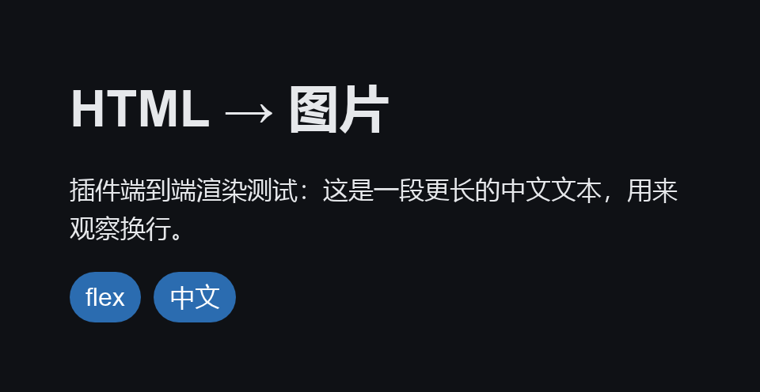

# fuyubot-plugin-html2img

## 这是什么

FuyuBot 的 **HTML / Vue 转图片服务插件**（Rust，cdylib），服务名 `fuyubot.html2img`，ABI v6。它自己不接收、
不回复聊天消息：启动时把进程级服务注册到宿主，别的插件用
`call_service("fuyubot.html2img", "render", …)` 就能把一段 HTML / CSS —— 或者一段 **Vue 模板** ——
渲染成 **PNG / JPEG**，拿到本地文件路径。默认输出 JPEG。

渲染器是 [hyper-render](https://github.com/thomasmost/hyper-render) 的**本地 vendored fork**（在 `vendor/hyper-render/`，只开 `png` 特性）——纯 Rust 的 Blitz + Stylo + Taffy + Vello CPU。**不需要 Chromium / WebKit / Node / 外部进程**，也没有额外的运行时，和 sqlite / mongo / adblock 一样解压即用。



> 上面这张图由本插件渲染：960×496 PNG，中文、flexbox、圆角与 `prefers-color-scheme` 都来自 hyper-render。

## 安装

把 zip 解压到机器人的插件目录（或走 TUI 商店）：

```text
plugins/
└── fuyubot.html2img/
    ├── plugin.json
    └── bin/fuyubot_plugin_html2img.dll
```

Windows 用 `fuyubot_plugin_html2img.dll`，Linux / Android 用 `libfuyubot_plugin_html2img.so`，macOS 用
`libfuyubot_plugin_html2img.dylib`。启动后日志里会出现 `html2img 服务已就绪：fuyubot.html2img（…）`。

需要在别的插件里用它，把 `fuyubot.html2img` 写进那个插件的依赖声明（`inject()` / `soft_inject()`），
宿主会保证调用前服务已经就绪。

## 服务契约

服务名 `fuyubot.html2img`（进程级共享），只有一个方法 `render`。所有入参、出参都是 JSON。

入参（只有 `html` 必填，其余省略就用配置里的默认值）：

```json
{
  "html": "<h1>{{ title }}</h1><p style=\"color:#c00\">{{ body }}</p>",
  "vue": true,
  "data": { "title": "你好", "body": "HTML 渲染" },
  "width": 960,
  "height": 496,
  "scale": 1.0,
  "dark": false,
  "transparent": false,
  "auto_height": true,
  "format": "jpg"
}
```

| 字段 | 类型 | 说明 |
| --- | --- | --- |
| `html` | string | **必填**。要渲染的 HTML，片段或完整文档都行；`vue = true` 时当 Vue 模板 |
| `vue` | boolean | `true` 时先用 `data` 把 `html` 当 Vue 模板编译成 HTML，默认 `false` |
| `data` | object | Vue 模板的数据；`vue = true` 且不传时按 `{}` |
| `width` | integer | 视口宽度（CSS px） |
| `height` | integer | 视口高度；`auto_height` 时只作下限参考 |
| `scale` | number | 输出倍率，`2.0` ≈ 高清屏 |
| `dark` | boolean | 深色底，同时影响 `prefers-color-scheme` |
| `transparent` | boolean | 透明底（只对 PNG 有意义，JPEG 会压到白底） |
| `auto_height` | boolean | 高度按内容撑开 |
| `format` | string | `png` / `jpg`（也认 `jpeg`）；省略则用配置里的默认值，默认 `jpg` |

成功：

```json
{"ok": true, "path": "/tmp/fuyubot-html2img/html2img_1234_0.jpg", "format": "jpg", "width": 960, "height": 496, "bytes": 12345}
```

`path` 是渲染产物在**本机**的路径（图片不适合塞进 JSON 当 base64），调用方要在 24 小时内用掉
（发送、转存、二次处理都行）；插件启动时会清掉超过 24 小时的旧文件。

失败：

```json
{"ok": false, "error": "HTML 太大（200000 字节，上限 131072）"}
```

错误信息是中文句子，调用方按 `ok` 判断成败、把 `error` 原样展示或记日志即可。常见的有：
缺少字段 `html`、HTML 太大、不支持的 `format`、Vue 模板编译失败：…、Vue 渲染失败：…、
请求的尺寸超过插件配置的上限、尺寸太大（…，像素上限 …）、渲染失败：…。

### 尺寸、清晰度与体积

- **高度自适应**：`auto_height = true`（默认）时按内容撑开，返回的 `height` 是真实像素高；设成 `false` 就固定用 `height`。
- **宽度不自适应**：宽度是**布局用的视口宽度**——它决定换行、flex/grid 的分配，所以不会跟着内容缩短。输出宽度恒为 `width × scale`，内容比视口窄时右侧会留白；想要贴合内容就按内容宽度传 `width`。
- **清晰度**：由 `scale` 决定（输出像素倍率）。`1.0` = CSS 像素 1:1，`2.0` ≈ 高清屏；调大更清晰、文件也更大。
- **体积**：JPEG 用 `jpeg_quality`（默认 85）控制画质与体积，PNG 无损但明显更大；透明背景只有 PNG 保留得下来。

### 最小 Rust 调用示例

```rust
use fuyubot_abi::HostApi;

fn render(host: &HostApi, html: &str) -> Result<std::path::PathBuf, String> {
    let input = serde_json::json!({ "html": html, "width": 640, "scale": 2.0 });
    let reply = host
        .call_service("fuyubot.html2img", "render", &input.to_string())
        .map_err(|error| format!("调用 fuyubot.html2img 失败：{error}"))?;
    let value: serde_json::Value = serde_json::from_str(&reply)
        .map_err(|error| format!("服务返回的不是 JSON：{error}"))?;
    if value["ok"] != true {
        return Err(value["error"].as_str().unwrap_or("未知错误").to_owned());
    }
    value["path"]
        .as_str()
        .map(std::path::PathBuf::from)
        .ok_or_else(|| "服务没返回 path".to_owned())
}
```

渲染 Vue 模板只是在入参里多给两个字段，其余完全一样：

```rust
let input = serde_json::json!({
    "html": "<h1>{{ title }}</h1>",
    "vue": true,
    "data": { "title": "你好" },
    "format": "png",          // 想要无损 / 透明就显式要 png
});
```

## 配置

FuyuBot 配置文件的 `[plugin.fuyubot.html2img]` 段，全部可选：```toml
[plugin.fuyubot.html2img]
width = 1024              # 视口宽度（CSS px）
height = 768              # 视口高度
scale = 1.0               # 输出倍率
auto_height = true        # 高度按内容撑开（长页面不被截断）
dark = false              # 深色底
transparent = false       # 透明底
padding = 20              # 片段模式下 body 内边距
# font_family = "system-ui, ..."   # 片段模式的字体栈
# temp_dir = "/var/tmp/fuyubot-html2img"  # 渲染产物目录；不写 = 系统临时目录

format = "jpg"            # 默认输出格式：jpg / png
jpeg_quality = 85         # JPEG 质量（1–100）

# 防滥用上限（单次请求超过就报错，不渲染）
max_width = 1920
max_height = 6000
max_scale = 3.0
max_html_bytes = 131072
max_pixels = 16000000
```

这里的值就是 `render` 入参省略时的默认值；入参里显式给出的 `width` / `height` / `scale` 会被夹到
`max_*` 范围内，超出总像素预算（宽 × 高 × scale²）的请求直接返回错误。

没有 `<html>` 的片段会补成一份带基础 CSS 的文档（白/黑底、字体栈、内边距、`img{max-width:100%}`）；
完整文档则把基础样式插到 `<head>` 最前面，你自己的样式在后面自然覆盖。

## 平台支持

| 平台 | 说明 |
| --- | --- |
| Windows x86_64 / aarch64 | 开箱可用，字体走系统字体 |
| Linux x86_64 / aarch64 | 需要 fontconfig（桌面发行版默认有，精简容器装 `libfontconfig1`）；渲染中文再装一套 CJK 字体（如 `fonts-noto-cjk`） |
| macOS aarch64 | 系统 CoreText 字体 |
| Android aarch64 / x86_64 | 系统字体走 `fonts.xml`，不需要 fontconfig |

默认字体栈先吃系统 UI 字体，再按平台补中文 / 日文 / 韩文字体；想换字体名就改配置里的
`font_family`（只接受 CSS 字体名里合法的字符）。

## 注意

- **只加载公网资源**：`` 支持 `data:` 与公网 `http(s)`；`file://`、相对路径、私网 / 回环 / link-local 地址与远程样式表（`<link rel="stylesheet">` / `@import`）都不加载。
- **远程资源有硬上限**：单份 8 MiB、连接 5 s / 读取 10 s、最多 3 次跳转，每次跳转都重新校验目标，只接受图片 / 字体 MIME；代理走 `HTTPS_PROXY` / `HTTP_PROXY` / `ALL_PROXY`。
- **不执行 JavaScript**，脚本标签不会运行；需要交互结果请先在别处算好，渲染时只给静态 HTML。
- **高级 CSS 不一定生效**：`position: sticky`、复杂 `transform` 一类特性在 Blitz 下不生效，版式尽量用 flex / grid 与静态定位表达。
- **同步调用**：`render` 在调用方线程上跑完才返回，大图会占用调用线程一段时间；每次调用受 HTML 字节数、宽高、`scale`、总像素预算约束，超限直接返回错误而不渲染。
- **格式代价**：`jpg` 默认质量 85，体积通常只有 PNG 的几分之一，但没有 alpha——透明区域会合成到白底；需要透明或无损时传 `format: "png"`。
- **Vue 模板只做静态渲染**：`vue = true` 时按本仓库 `vue-template-html` 的语义编译，没有 JS 运行时，`v-on` / `v-model` 之类不会生效（详见那个 crate 的 README）。
- **超出 Telegram 照片规格会在控制台告警**：成品体积 > 10 MB、宽 + 高 > 10000 像素、或长宽比 > 20:1 时，插件打一条 `warn` 日志提醒「当照片发会被 Telegram 压缩，要原图请按文件发送」；只提示，不拦截，图片照常返回。
- **服务不区分调用方**：同进程的插件都能调它；渲染的 HTML 会去访问其中的公网图片 / 字体 URL（已拒绝 `file://`、私网、回环），需要对外限流就在调用方控制频率。

## 来源与致谢

- 渲染器来自 [hyper-render](https://github.com/thomasmost/hyper-render)，本项目维护的是本地 vendored fork（`vendor/hyper-render/`，不发布到 crates.io，默认只开 `png` 特性）。
- Vue 模板编译用本仓库的 [vue-template-html](../vue-template-html/)（纯 Rust 的 Vue 3 模板 → HTML，语义对照 `vuejs/core`，不含 Vue 源码）。
- PNG → JPEG 转码用 [`image`](https://crates.io/crates/image)（只开 `jpeg` / `png` 编解码）。
- 本地副本合并了 upstream [PR #1](https://github.com/thomasmost/hyper-render/pull/1)：升级到 blitz `0.3.0-alpha.4`，加入 `data:` URI 资源支持（内联 base64 图片 / `@font-face`）并暴露 `StyleThreading`（插件固定使用 `Sequential`）。
- 外部 URL 资源能力对应 upstream [PR #3](https://github.com/thomasmost/hyper-render/pull/3)：该 PR 基于 blitz 0.2 的 `blitz-net`，与本 fork 的 blitz 0.3 不兼容，因此在同一个 `NetProvider` 钩子上用阻塞 HTTP 客户端实现了等价能力，带 SSRF 防护。
- 底层是 Blitz（HTML/CSS 布局）、Stylo（Firefox 的 CSS 引擎）、Taffy（Flexbox/Grid）与 Vello（CPU 光栅化）。
- 感谢 hyper-render、Blitz 社区以及上述 PR 的作者。

## License

MIT OR Apache-2.0
